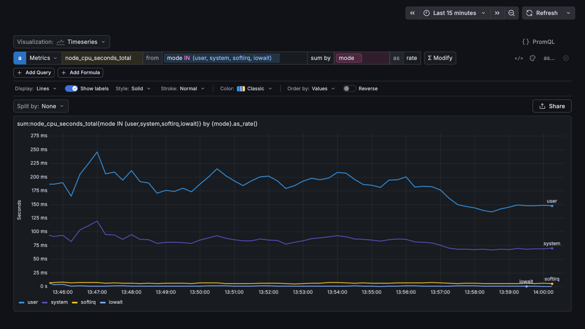
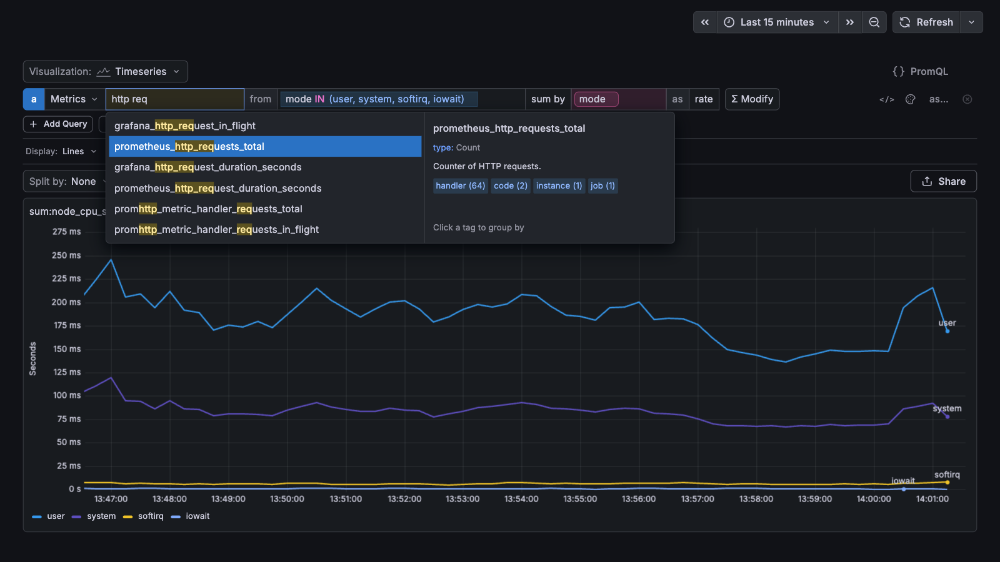
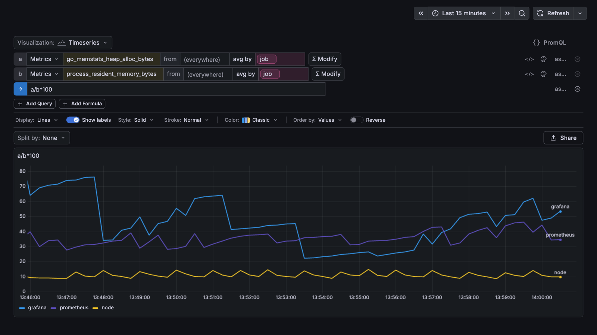
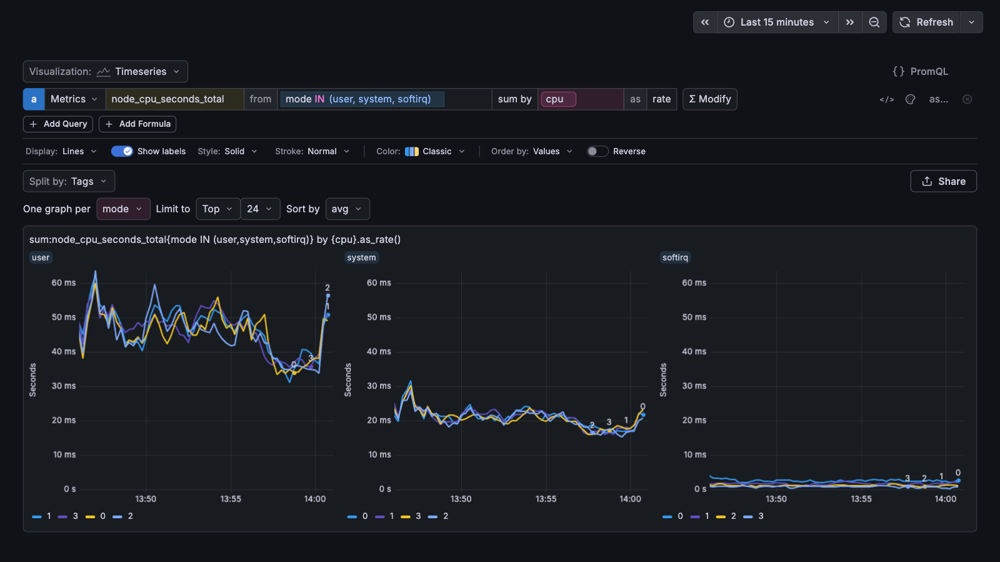

# Metrics Explorer for Grafana

A Grafana panel plugin for exploring Prometheus metrics without writing PromQL. Pick a metric with autocomplete,
filter and group it by tags, add functions and formulas, and switch between line, bar, top-list and other views. The
panel writes the PromQL itself, keeps its state in the URL so that a link reopens the same view, and protects the
backend with a time-range cap and series limits.



- [Features](#features)
- [Compatibility](#compatibility)
- [Installation](#installation)
- [Creating the dashboard](#creating-the-dashboard)
- [Usage](#usage)
- [Deep links](#deep-links)
- [Panel options](#panel-options)
- [Query semantics and safety limits](#query-semantics-and-safety-limits)
- [Development](#development)
- [Releasing](#releasing)

## Features

- **Query rows** `a | Metrics | <metric> | from (everywhere) | avg by (everything) | Σ Modify`, with ranked metric
  autocomplete, a preview of unit, type, description and tag keys, and tag suggestions for filters and grouping.
- **Tag filters** with negation, wildcards, `IN` / `NOT IN` lists and boolean expressions with `AND`, `OR`, `NOT` and
  parentheses; grouping by any tag keys.
- **Functions** (Σ Modify): arithmetic, boolean remapping, interpolation, timeshift, rate, smoothing, rollup, rank,
  count, regression and exclusion, shown as editable pills under the row.
- **Raw text mode** (`</>`) per row, e.g. `sum:http_requests_total{env:prod} by {service}.as_count()`.
- **Formulas** over the query letters (`a / b * 100`), with aliases; hidden queries still feed formulas.
- **Visualizations**: timeseries (lines, bars, areas), query value, table, heatmap, distribution, top list, bar chart
  and pie chart.
- **Display options**: value labels on the line, line style and stroke, eleven palettes (Classic, Vivid, Consistent
  and sequential ones), order by tags or values, per-query colour overrides.
- **Split by** a tag: one graph per tag value.
- **Share**: copy link, copy PromQL, open the compiled queries in Grafana Explore.
- **Counters done right**: delta (OpenTelemetry) and cumulative counters, histograms and CloudWatch metric streams
  each get their own PromQL template; the step is aligned with the metric's export cadence.

## Compatibility

| Component      | Supported                                                                                          |
| -------------- | -------------------------------------------------------------------------------------------------- |
| Grafana        | 13.1 or later                                                                                      |
| Prometheus     | 2.33 or later and 3.x (the series cap uses the `@` modifier, on by default since 2.33)             |
| OpenObserve    | 1.1 or later, through its Prometheus API (`/api/<org>/prometheus`)                                 |
| Delta counters | OpenTelemetry delta sums, recognised by `aggregation_temporality="AGGREGATION_TEMPORALITY_DELTA"`  |
| Histograms     | classic `<m>_bucket` / `_sum` / `_count` families, with OpenTelemetry `_min` / `_max` when present |
| CloudWatch     | metric streams in OpenTelemetry format: `amazonaws_com_<namespace>_<metric>` summaries             |

The panel queries a Grafana Prometheus datasource, so any backend that implements the Prometheus HTTP API
(`query_range`, `labels`, `label/<key>/values`, `series`, `metadata`) should work; other backends are untested.

OpenObserve quirks the plugin works around:

- A regex alternation is anchored per branch (`a|b` runs as `^a|b$`), so every regex the plugin writes is grouped as
  `(?:a|b)`.
- There is no series limit, so the plugin never sends an unaggregated selector and caps grouped queries (see
  [safety limits](#query-semantics-and-safety-limits)).
- `@` is rejected on a subquery, so the group ranking is a separate expression instead of a wrapper.
- The label values API can answer 500 without a time window, so tag value calls carry one (at most 24 h). A
  metric's tag keys are read without one, because a short window hides sparse streams.

## Installation

The plugin is not signed, so Grafana loads it only when its id is listed in `allow_loading_unsigned_plugins`. Each
[release](https://github.com/skip-pay/grafana-metrics-explorer/releases) has a zip with the plugin directory
`skippay-metricsexplorer-panel/` and its `.sha256` checksum.

### grafana.ini or environment

```ini
[plugins]
allow_loading_unsigned_plugins = skippay-metricsexplorer-panel
preinstall = skippay-metricsexplorer-panel@0.2.1@https://github.com/skip-pay/grafana-metrics-explorer/releases/download/v0.2.1/skippay-metricsexplorer-panel-0.2.1.zip
```

The same as environment variables: `GF_PLUGINS_ALLOW_LOADING_UNSIGNED_PLUGINS` and `GF_PLUGINS_PREINSTALL`. Both
settings take comma-separated lists, so append to values you already have.

- `preinstall` installs in the background at startup, follows GitHub's redirect to the download and registers the
  panel without a restart. With a persistent `/var/lib/grafana`, a restart on the same version downloads nothing;
  a new version replaces the old one.
- If the download fails, Grafana keeps running and logs `Failed to install plugin`, but the old version has already
  been removed, so the panel is missing until the next successful start. Publish the release before you bump the
  version in the configuration.
- Prefer `preinstall` to `preinstall_sync`: with `preinstall_sync` a failed download makes Grafana exit.
- `GF_INSTALL_PLUGINS` with `<url>;<id>` also works but is deprecated and carries no version.

### Helm chart

With the Grafana Helm chart, put the same settings under `grafana.ini` (the chart's `plugins:` list uses the
deprecated `GF_INSTALL_PLUGINS`):

```yaml
grafana.ini:
  plugins:
    allow_loading_unsigned_plugins: skippay-metricsexplorer-panel
    preinstall: skippay-metricsexplorer-panel@0.2.1@https://github.com/skip-pay/grafana-metrics-explorer/releases/download/v0.2.1/skippay-metricsexplorer-panel-0.2.1.zip
```

### Docker

```bash
docker run -d -p 127.0.0.1:3000:3000 \
  -e GF_PLUGINS_ALLOW_LOADING_UNSIGNED_PLUGINS=skippay-metricsexplorer-panel \
  -e GF_PLUGINS_PREINSTALL=skippay-metricsexplorer-panel@0.2.1@https://github.com/skip-pay/grafana-metrics-explorer/releases/download/v0.2.1/skippay-metricsexplorer-panel-0.2.1.zip \
  grafana/grafana:13.1.1
```

### Grafana CLI or by hand

```bash
grafana cli --pluginUrl https://github.com/skip-pay/grafana-metrics-explorer/releases/download/v0.2.1/skippay-metricsexplorer-panel-0.2.1.zip \
  plugins install skippay-metricsexplorer-panel
```

Or download the zip, check it with `sha256sum -c skippay-metricsexplorer-panel-0.2.1.zip.sha256`, unzip it into
Grafana's plugin directory (`/var/lib/grafana/plugins` by default) and restart Grafana.

## Creating the dashboard

The explorer is meant to be the only panel of its dashboard.

- **Import** [`demo/provisioning/dashboards/metrics-explorer.json`](demo/provisioning/dashboards/metrics-explorer.json)
  (Dashboards → New → Import). It has the uid `metrics-explorer`, one full-width transparent panel on your default
  Prometheus datasource (pick another in the panel options), the time range `now-1h` and quick ranges up to 24 h.
- **Or add a panel** to a new dashboard, choose the **Metrics Explorer** visualization, clear its title, make it
  transparent and give it the full width.

The panel fills its grid cell. Open the dashboard with `?autofitpanels` to stretch it to the window height, and add
`&kiosk` to hide Grafana's navigation: `/d/metrics-explorer?autofitpanels&kiosk`. Keep the dashboard's quick ranges
within the panel's maximum range.

## Usage

### Query rows

- **Letter** (`a`, `b`, …): click to hide or show the row. Letters are never reused, so formulas keep pointing at the
  right row.
- **Metric**: type any part of the name. The list ranks matches and previews the highlighted metric; click a tag in
  the preview to group by it.

  

- **from**: tag filters, one chip each, ANDed. Filters on the same key in one AND list match either value
  (`env:prod, env:dev` selects both environments); exclusions of one key all apply.

  | Filter                                         | Matches                                       |
  | ---------------------------------------------- | --------------------------------------------- |
  | `env:prod`                                     | the tag equals the value                      |
  | `!env:prod`                                    | the tag differs or, on Prometheus, is missing |
  | `service:api-*`                                | wildcard; `*` matches any characters          |
  | `service:*`                                    | the tag is present                            |
  | `env IN (prod,dev)`                            | any of the values                             |
  | `env NOT IN (dev)`                             | none of the values                            |
  | `service:api OR path:/health`                  | either filter                                 |
  | `NOT (method:GET OR method:HEAD)`              | neither filter                                |
  | `env:prod AND (service:api OR service:worker)` | parentheses group filters                     |

  `AND`, `OR` and `NOT` are uppercase; `NOT` binds tighter than `AND`, `AND` (or a comma) tighter than `OR`. Typing
  suggests tag values for the term at the cursor, also inside `(` and as the values of `key IN (`, and `AND`, `OR`
  and `)` after a complete term and a space, where Enter closes the open parenthesis or adds the text. Enter adds
  the text once its parentheses are closed; a group becomes one chip such as `(service:api OR service:worker)`, and
  a click on a chip turns it back into text. In this field a comma outside parentheses always ends a chip, so
  `a:1 OR b:2, c:3` typed here means `(a:1 OR b:2), c:3`. Typed after the chips, `OR …` joins the last chip
  (`service:api`, then `OR service:worker`, gives `(service:api OR service:worker)`) and `AND …` adds a chip.

- **avg by**: the space aggregation (`avg`, `sum`, `min`, `max`; distributions add `count` and `p50`…`p99`) and the
  tags to group by. Counters start as `sum by` and show an `as count | rate` switch.
- **Σ Modify**: adds a function. Applied functions appear as pills under the row; click one to edit its arguments.
- **Row actions**: `</>` edits the row as text, the palette sets the row's colour or palette, `as…` sets an alias,
  `⊗` deletes the row (not while a formula uses it).

### Query text

The `</>` mode and the [`q` link parameter](#deep-links) use this form:

```text
<aggregator>:<metric>{<filters>} by {<tag>,…}.<modifier>(…)
<function>(<query>, <arguments>…)
```

- `<aggregator>`: `avg`, `sum`, `min`, `max`, `count`, `p50`, `p75`, `p90`, `p95`, `p99`. Without it (`metric{*}`)
  the metric's default applies.
- `{*}` or `{}` means no filter; otherwise the filters above, separated by commas or combined with `AND`, `OR`,
  `NOT` and parentheses: `{env:prod AND (service:api OR service:worker), !status:5*}`. A comma is `AND` here, so
  `{a:1 OR b:2, c:3}` is `a:1 OR (b:2 AND c:3)`; the explorer writes groups in parentheses. Quote values that
  contain `,`, `{`, `}`, `(`, `)`, `"`, `\` or a separate word `AND` or `OR`: `path:"/a,b"`.
- `by {…}` is optional; it may also follow the modifiers (`….as_count() by {service}`).
- Dotted modifiers follow the query: `.as_count()`, `.as_rate()`, `.rollup(<agg>, <seconds>)` (or `.rollup(60)`),
  `.fill(<method>, <limit>)`.
- Every other function wraps the query, innermost first: `abs(timeshift(avg:m{*}, -3600))`. String arguments may be
  quoted: `top(avg:m{*} by {host}, 10, 'max', 'desc')`.
- Dots and underscores in metric names are interchangeable when the name is in the catalogue:
  `http.requests.total` finds `http_requests_total`.

### Functions

| Category          | Functions                                                                                                        |
| ----------------- | ---------------------------------------------------------------------------------------------------------------- |
| Arithmetic        | `abs`, `log2`, `log10`, `cumsum`, `integral`, `ceil`, `floor`, `round(decimals=0)`                               |
| Boolean remapping | `is_greater(threshold)`, `is_less(threshold)`, `is_between(lower, upper)`                                        |
| Interpolation     | `.fill(method=null\|zero\|linear\|last, limit=300)`, `default_zero`                                              |
| Timeshift         | `timeshift(seconds=-3600)`, `hour_before`, `day_before`, `week_before`, `month_before` (28 days)                 |
| Rate              | `per_second`, `per_minute`, `per_hour`, `diff`, `monotonic_diff`, `derivative`, `throughput`                     |
| Smoothing         | `ewma_3`, `ewma_5`, `ewma_10`, `ewma_20`, `median_3`…`median_9`, `rollingavg_5`, `_13`, `_21`, `_29`             |
| Rollup            | `.rollup(agg=avg\|count\|max\|min\|sum, seconds=0)` (0 = automatic), `moving_rollup(seconds=300, agg)`           |
| Rank              | `top(n=5, by=mean, dir=desc)`, `bottom(…)`; `n` 5, 10, 25, 50, 100; `by` mean, max, min, sum, last, l2norm, area |
| Count             | `.as_count()`, `.as_rate()`, `count_nonzero`, `count_not_null`                                                   |
| Regression        | `trend_line`                                                                                                     |
| Exclusion         | `exclude_null`, `cutoff_min(threshold)`, `cutoff_max(threshold)`, `clamp_min(threshold)`, `clamp_max(threshold)` |
| Formulas only     | `minimum(x, y)`, `maximum(x, y)`, `pow(x, y)`, `time()`                                                          |

Functions run as PromQL while every function so far has a PromQL form; from the first one that does not, the rest
of the chain runs in the browser.

### Formulas

**+ Add Formula** adds an expression over the query letters with `+`, `-`, `*`, `/`, parentheses and numbers, e.g.
`a / b * 100`. Functions that are not modifiers take the series as their first argument (`abs(a - b)`,
`top(a, 10, 'mean', 'desc')`); `minimum`, `maximum` and `pow` take two (`maximum(a, b)`). Series are matched by their
common group tags. Hide the queries a formula uses by clicking their letters.



### Display

- **Visualization**: timeseries, query value, table, heatmap, distribution, top list, bar chart, pie chart.
- **Timeseries**: `Display` lines, bars or areas (counters suggest bars), `Show labels` (peak values and series names
  at the line ends), `Style`, `Stroke`, `Color` palette, `Order by` tags or values, `Reverse`.
- **Top list, query value, table**: `Aggregation` over the time range (avg, sum, min, max, last); the top list also
  has a `Limit`.
- **Legend**: click a series to isolate it, click again to show all; Ctrl/Cmd-click toggles one series.
- **PromQL** (top right) lists the compiled expression of every row.

### Split by

On a timeseries, `Split by: Tags` draws one graph per value of a tag, limited to the top or bottom 6, 12, 24 or 48
values (top 24 by default) ranked by avg, max, min or sum.



### Keyboard

| Where                  | Keys                                                                                                                     |
| ---------------------- | ------------------------------------------------------------------------------------------------------------------------ |
| Metric                 | ↑ ↓ move, Enter picks (or keeps the typed name), Tab completes the highlighted metric, Esc closes                        |
| from, by               | ↑ ↓ move, Enter picks or adds the typed text, `,` adds it, Backspace on an empty field removes the last chip, Esc closes |
| from, in `(` or `IN (` | Enter picks and keeps editing until the last parenthesis is closed; `,` separates terms or values                        |
| Σ Modify               | type to search, ↑ ↓ move, → opens a category, ← goes back, Enter adds, Esc closes                                        |
| `</>` text mode, alias | Enter applies, Esc cancels                                                                                               |

## Deep links

The full state is the URL parameter `mx` (JSON), which **Share → Copy link** produces. For links written by hand or
by tools, the explorer also reads readable parameters on the dashboard URL `<grafana>/d/<dashboard uid>`:

| Parameter    | Value                                                                                                          |
| ------------ | -------------------------------------------------------------------------------------------------------------- |
| `q`          | one query row in the [query text](#query-text) form; repeat it for more rows, lettered `a`, `b`, `c`… in order |
| `f`          | a formula over those letters, e.g. `a/b*100`; repeatable. With at least one valid `f`, the `q` rows are hidden |
| `viz`        | `timeseries`, `queryvalue`, `table`, `heatmap`, `distribution`, `toplist`, `barchart`, `piechart`              |
| `display`    | `lines`, `bars`, `areas`                                                                                       |
| `split`      | a tag key: one graph per value, top 24                                                                         |
| `from`, `to` | Grafana's time range, e.g. `from=now-6h&to=now`; ranges over the panel's maximum (24 h by default) are refused |

- When `mx` is present it wins and the readable parameters are ignored. Otherwise the state is built from them and
  the URL is rewritten in place to carry `mx` instead.
- Parameters that do not parse are named in a warning banner; everything that parsed is still shown.
- Encode each value with `encodeURIComponent`. In particular `+` must be `%2B` (a bare `+` means a space), and `&`,
  `#` and `%` must be encoded.

Examples (shown unencoded for readability):

```text
/d/metrics-explorer?q=avg:node_load1{*}&from=now-1h&to=now
/d/metrics-explorer?q=sum:http_requests_total{env:prod,!status:5*} by {service}.as_count()&display=bars
/d/metrics-explorer?q=sum:http_requests_total{env:prod, NOT (method:GET OR method:HEAD)} by {service}.as_count()
/d/metrics-explorer?q=sum:http_requests_total{status:5*} by {service}.as_count()&q=sum:http_requests_total{*} by {service}.as_count()&f=a/b*100
/d/metrics-explorer?q=top(avg:node_cpu_seconds_total{mode:idle} by {cpu}, 5, 'mean', 'desc')
/d/metrics-explorer?q=avg:node_load1{*} by {instance}&split=instance&from=now-6h&to=now
```

The same `q` encoded: `q=avg%3Anode_load1%7B*%7D%20by%20%7Binstance%7D`.

An agent skill that teaches AI agents to build these links is in
[`skills/metrics-explorer-links`](skills/metrics-explorer-links/SKILL.md).

## Panel options

| Option                 | Default                                                                   | Meaning                                               |
| ---------------------- | ------------------------------------------------------------------------- | ----------------------------------------------------- |
| Datasource             | the default datasource if it is Prometheus, else the first Prometheus one | the Prometheus datasource the explorer queries        |
| Max time range (hours) | 24                                                                        | longer dashboard time ranges are refused, not queried |

A configured datasource that does not exist or is not a Prometheus one, as after importing a dashboard from another
instance, gives the default.

## Query semantics and safety limits

- **Time range.** Ranges over the maximum are refused rather than queried; long raw reads can overload the backend.
- **Step.** The step follows the range (under 300 points for lines, at most 100 bars) and is a multiple of every
  queried metric's export or scrape interval, so each bucket holds the same number of samples and delta counters do
  not saw-tooth. Intervals over a quarter of the range are left out; each bucket then holds at most one of their
  samples. The interval is detected with instant `count_over_time` queries on the metric's densest series: its
  samples in the last 10 min and the most in any 2 min of them, which an interval under a minute needs, and its
  samples in the last 6 h for streams too sparse for that, such as recording rules. It is cached for 10 min, and it
  is 60 s when it cannot be detected, for sparse delta counters and for CloudWatch streams.
- **Timestamps.** PromQL stamps the window `(t − step, t]` at `t`; the explorer draws it at `t − step`, the start of
  its bucket. The first bucket the query returns ends before the range starts; it only warms up rates and smoothing
  and is not drawn or counted, so a table or top list summing a counter over the last hour equals
  `sum_over_time(m[1h])`.
- **Delta and cumulative counters.** The `aggregation_temporality` label picks the template. Delta counters sum their
  points per step (`sum_over_time(m[step])`); avg, min and max first sum away the labels that split one producer's
  points (`start_time`, `exemplars` and `flag`, which OpenObserve adds to OpenTelemetry points, and the per-process
  `instance_id`) unless the query groups or splits by them, and `as_rate` divides by the step. Cumulative counters,
  including scraped ones without the label, use `rate(m[R])` with `R = max(step, 4 × export interval)`; `as_count`
  multiplies it by the step, so it is a smoothed estimate, not an exact count. Distributions follow the same split on
  their `_bucket`, `_sum` and `_count` streams.
- **Boolean filters.** `NOT` is pushed down to the tag matchers (`NOT (a OR b)` is `!a AND !b`) and the filter is
  expanded into OR branches. Branches that differ only in the values of one key become one regex matcher, so
  `env:prod AND (service:api OR service:worker)` stays one selector, `{env="prod",service=~"(?:api|worker)"}`.
  Otherwise every read of the metric is repeated per branch and the reads are joined with PromQL `or` before the
  space aggregation: `sum(A or B)`, where `A` and `B` are `sum_over_time(m{…}[60s])` with each branch's matchers.
  `or` keeps a series that two branches select once. A filter may have at most 16 branches. Tag suggestions and the
  group estimate of the series cap use only the top-level terms outside groups, so they are an upper bound.
- **Missing and empty labels.** Exclusions (`!key:value`) use plain `!=`/`!~` matchers: Prometheus keeps series
  that do not carry the key, OpenObserve drops them. Add `key:*` to require the key on both. Grouping can return a
  series without the key next to one where it is empty; legends show them as `N/A` and `""`.
- **Series cap.** The explorer never sends an unaggregated selector. A grouped query with more than about 200 groups
  is narrowed to the 200 with the highest value over the whole range, and a row with more than 1000 series is not
  drawn.
- **Requests.** Queries run one request at a time with at most three queries each, and a run is cancelled after
  30 s. Tag values are read over the time range, at most its last 24 h; metric names, metadata and a metric's tag
  keys have no time window.

## Development

Node 24 (`.nvmrc`). The project was scaffolded with `@grafana/create-plugin`; `.config/` is managed by it, so extend
it from the root config files.

```bash
npm ci
npm run typecheck
npm run lint            # npm run lint:fix also runs Prettier
npx prettier --check .
npm test
npm run build           # dist/: plugin.json, module.js, logo.svg, LICENSE and a source map
npm run dev             # rebuilds dist/ on every change
```

### Demo

[`demo/docker-compose.yaml`](demo/docker-compose.yaml) runs Prometheus (scraping itself, node-exporter and Grafana,
so there are gauges, counters and histograms) and Grafana 13.1.1 with the built plugin from `dist/`, a provisioned
Prometheus datasource and the explorer dashboard.

```bash
npm ci && npm run build && docker compose -f demo/docker-compose.yaml up
```

Open <http://localhost:3000/d/metrics-explorer> (anonymous viewer; sign in as `admin` / `admin` to edit).
`GRAFANA_PORT=3001` changes the port. With `npm run dev` running, reload the page with the browser cache disabled;
a `plugin.json` change needs `docker compose -f demo/docker-compose.yaml restart grafana`.

## Releasing

1. `npm version --no-git-tag-version X.Y.Z` (updates `package.json` and `package-lock.json`; the build writes the
   version into `plugin.json`).
2. Add a `## X.Y.Z` section to `CHANGELOG.md`; it becomes the release notes.
3. Commit, then tag and push: `git tag vX.Y.Z && git push origin main vX.Y.Z`.

The [release workflow](.github/workflows/release.yml) checks that the tag matches `package.json`, runs the checks,
builds, packs `skippay-metricsexplorer-panel-X.Y.Z.zip` with [`scripts/package.sh`](scripts/package.sh) and creates
the GitHub release with the zip and its `.sha256`. `npm run build && scripts/package.sh` makes the same zip locally in
`artifacts/`.

Bump the version on every release: Grafana's only cache-buster for `module.js` is the plugin version.

## License

[MIT](LICENSE)
